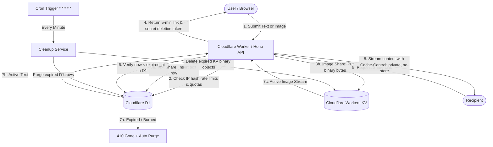

# BlinkShare Architecture (100% Free Plan)

BlinkShare is a high-performance, edge-native ephemeral sharing application designed specifically for Cloudflare's **100% Free Tier**.

## Core Philosophy

1. **Hard 300-Second Invariant**: Every piece of content expires 300 seconds (5 minutes) after creation. This duration is strictly non-negotiable.
2. **Zero Residual Storage**: Expired content cannot be read or retrieved, even if scheduled physical cleanup has not completed.
3. **Free Edge Storage (Workers KV & D1)**:
   - Ephemeral text and metadata are stored in **Cloudflare D1** (SQLite).
   - Images are stored as raw binary objects in **Cloudflare Workers KV** (`IMAGE_STORE`).
   - Images are streamed through Worker API endpoints with strict non-caching headers (`Cache-Control: private, no-store, max-age=0`).
4. **Zero Billing & Zero Paid Infrastructure**: The system is architected to operate fully within Cloudflare Free tier quotas without credit cards or subscriptions.
5. **Privacy-Preserving Anti-Abuse**: Network identifiers are passed through a keyed cryptographic one-way hash (`HMAC-SHA256`) before rate limit counters are evaluated. Raw IP addresses are never persisted in logs or database tables.

---

## Monorepo Structure

```text
blinkshare/
├── apps/
│   ├── web/                     # React 18, TypeScript, Vite, Tailwind CSS (Cloudflare Pages)
│   │   ├── src/
│   │   │   ├── components/      # UI components (Header, Footer, Tabs, Timers, Modals)
│   │   │   ├── pages/           # Route views (Home, TextViewer, ImageViewer, Free Limits, Dashboard)
│   │   │   ├── hooks/           # useAuth, context providers
│   │   │   ├── api/             # Client API wrapper
│   │   │   └── styles/          # Tailwind and Prism syntax styling
│   │   └── public/
│   └── api/                     # Cloudflare Worker API (Hono.js)
│       ├── src/
│       │   ├── routes/          # /api/shares, /api/uploads, /api/plans, /api/account, /api/health
│       │   ├── middleware/      # securityHeaders, auth, rateLimit
│       │   ├── services/        # ShareService, CleanupService, RateLimitService, ImageStorageService (KV)
│       │   ├── repositories/    # D1 prepared SQL repositories + auto ensureSchema()
│       │   └── index.ts         # Worker entry point and cron trigger scheduled handler
│       ├── migrations/          # D1 versioned SQL schema (0001_initial_schema.sql)
│       └── test/                # Automated Vitest test suite with in-memory D1 and KV mocks
├── packages/
│   └── shared/                  # Common TypeScript types, free quota limits, Zod schemas, sensitive detection
├── docs/                        # Architecture, deployment, setup guides
├── wrangler.toml                # Cloudflare Worker, D1, KV, and Cron configuration
└── package.json                 # Monorepo root scripts
```

---

## Data Flow Diagram


